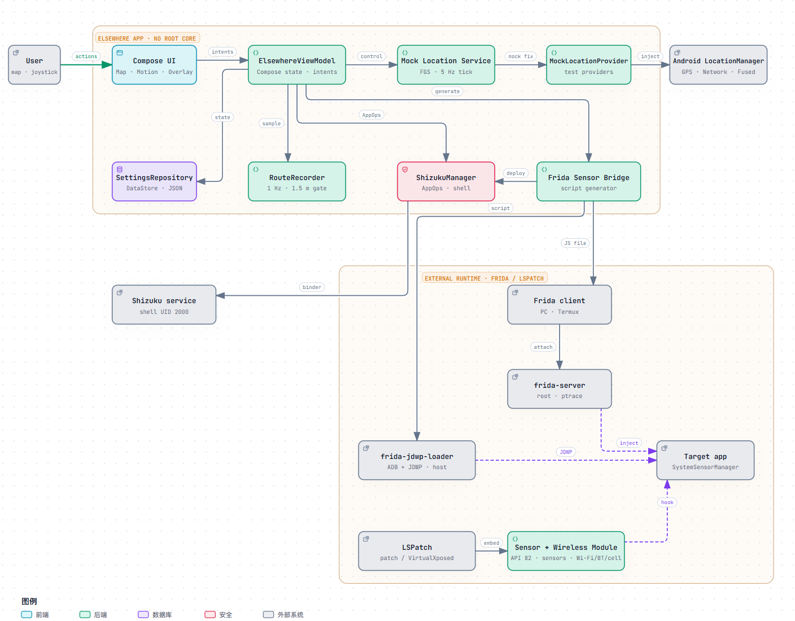
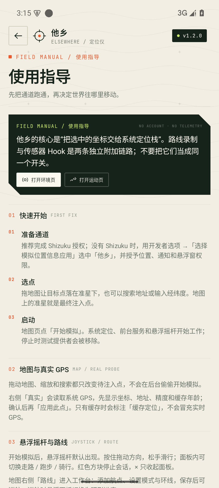
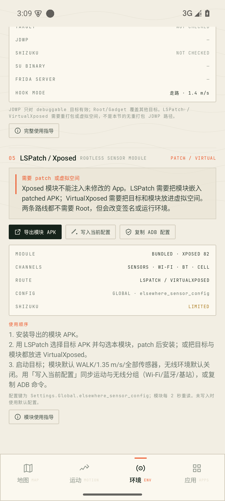

# 他乡 / ELSEWHERE

> Android 上的无 Root 位置仪。地图、准星、悬浮摇杆、路线，以及 JDWP 免 Root Frida / LSPatch 传感器与无线环境桥。

[中文](#中文) · [English](#english) · [Releases](https://github.com/CalciumSparks/ELSEWHERE/releases) · [Interactive architecture](docs/architecture/elsewhere-architecture.html)

[](docs/architecture/elsewhere-architecture.html)

> **最新 Release / Latest:** [`v1.1.0`](https://github.com/CalciumSparks/ELSEWHERE/releases/tag/v1.1.0) · 2026-10-29  
> **main / 1.2.0-dev:** LSPatch 模块新增虚拟无线环境（Wi-Fi / 蓝牙 / 蜂窝）；当前 release 仍为 v1.1.0。  
> `main` adds virtual wireless environment hooks (Wi-Fi / Bluetooth / cell) to the LSPatch module in 1.2.0-dev; the latest release remains v1.1.0.

---

## 中文

### 它是什么

他乡是一台**不需要 Root 的位置仪**：Shizuku 提供 shell 级通道，应用向 Android 的 GPS / Network / Fused 测试定位提供者写入坐标，地图负责选点和路线，前台服务维持输出，悬浮摇杆负责跨应用移动。

核心定位链路不需要 Root。**Frida 传感器桥是可选的高级外挂**，提供三条明确不同的路径：

- **JDWP（免 Root）**：通过 `frida-jdwp-loader` + ADB 注入，仅适用于 debuggable App；不重打包。
- **Root frida-server**：适用于任意 App，但设备必须 Root。
- **Frida Gadget**：无需 Root，但必须重打包并重新签名目标 APK。

没有外部注入环境时，应用只生成和部署脚本，不会假装已经 Hook 了其他 App。

另外还内置了一个 **LSPatch / VirtualXposed 的 classic Xposed 模块**（API 82）。它不需要 Root，但要求目标 APK 被 LSPatch patch，或目标运行在 VirtualXposed 的虚拟空间；它不是“注入任意未修改 App”的银弹。

### 核心能力

- 全屏地图、固定准星、拖图选点、地址搜索、经纬度输入。
- 高德栅格底图（GCJ-02 显示）与 OpenStreetMap；内部与注入始终 WGS-84。
- 一键开始 / 停止模拟；停止后移除测试提供者，系统定位恢复。
- 真实 GPS 两阶段确认：先显示坐标、地址、精度与缓存年龄，再手动应用。
- 走路 / 跑步 / 骑行，速度包络、步态节奏、步数、路线环线与漂移。
- 系统悬浮摇杆；路线巡航时自动切换为环形进度。
- 应用内摇杆、路线规划 / 保存 / 重播。
- **路线录制**：在模拟移动时采样实时轨迹，保存为可巡航 RoutePlan。
- Wi-Fi / 蓝牙 / 基站 extras、场景预设、应用内传感器推演。
- 应用扫描、缓存占用、手动系统清理入口、外部缓存快照。
- **Frida Sensor Bridge**：生成真实 JavaScript Hook，通过目标进程的 `SystemSensorManager` 改写六类传感器事件；支持 JDWP 免 Root（debuggable 目标）、Root frida-server 和 Frida Gadget 三种注入路径。
- **LSPatch / VirtualXposed Xposed 模块**：内置可导出的 API 82 模块 APK，供 patch/虚拟空间路线使用；读取当前 WALK/RUN/CYCLE 配置并可改写六类传感器事件。
- Shizuku / Root / Hook 诊断，GitHub Release 更新检查。

### 真实 / 模拟边界

| 能力 | 实际效果 | 说明 |
| --- | --- | --- |
| 系统定位 | **真实注入** | GPS / Network / Fused 测试提供者；Android 会标记为 mock。 |
| 坐标 / 运动 / 路线 / 漂移 | **真实注入** | 前台服务每 200 ms 推进并在测试提供者中更新。 |
| 悬浮摇杆 | **真实系统悬浮窗** | `TYPE_APPLICATION_OVERLAY`。 |
| 路线录制 | **应用内采样** | 采样当前被注入的坐标，保存为普通 RoutePlan。 |
| 应用内传感器 | **仅应用内推演** | 无 Root 无法把传感器流交给其他 App。 |
| Frida 传感器 Hook | **真实 Hook 脚本（外部注入）** | JDWP 免 Root 仅限 debuggable 目标；Root/Gadget 覆盖其他目标；只影响目标进程。 |
| LSPatch / Xposed 模块 | **真实 Hook（patch/虚拟空间）** | 目标 APK 需被 LSPatch patch，或运行在 VirtualXposed；API 82 模块，含运动传感器与无线环境。 |
| Wi-Fi / 蓝牙 / 基站 | **extras + 目标进程 Hook** | Location extras 之外，LSPatch 模块可改写被 patch 目标的 Wi-Fi/蓝牙/蜂窝 Java API；不改系统无线电扫描。 |
| 清理其他 App 缓存 | **系统页面手动完成** | Shizuku shell 不具备 `INTERNAL_DELETE_CACHE_FILES`。 |

### 安装

当前发行版是 [`v1.1.0`](https://github.com/CalciumSparks/ELSEWHERE/releases/tag/v1.1.0)。从 Release 下载 APK：

```bash
adb install elsewhere-1.1.0.apk
```

也可以从源码构建：

```bash
./gradlew :app:assembleDebug
adb install app/build/outputs/apk/debug/app-debug.apk
```

首次打开会进入三步校准。

### 准备 Shizuku（推荐）

1. 安装并启动 [Shizuku](https://github.com/RikkaApps/Shizuku/releases)。
2. 开启无线调试，按 Shizuku 指引启动服务。
3. 在「他乡 → 首次校准 / 系统与诊断」点击「打开 Shizuku 启动」。
4. 授权「他乡」，回到应用自动刷新。
5. 点击「授权 / 配置」，应用会通过 shell 完成模拟位置 AppOp、悬浮窗与通道检查。

没有 Shizuku 时也能使用核心模拟定位：在开发者选项 →「选择模拟位置信息应用」中选择「他乡」，授予精确位置、通知与悬浮窗权限即可。

### 完整使用指导

> 软件内也有同一份指导：**设置 → 使用指导**。下面是带命令和排查点的 README 版本。



#### 1. 首次启动与权限

1. 首次打开完成三步校准。
2. 推荐安装并启动 Shizuku，在他乡内授权后点「授权 / 配置」；Shizuku 会完成模拟位置 AppOp、悬浮窗与通道检查。
3. 没有 Shizuku 时：开发者选项 →「选择模拟位置信息应用」→ 他乡；再授予精确位置、通知、悬浮窗权限。
4. 先看「设置 → 系统与诊断」：Shizuku、AppOp、悬浮窗、Hook 信号应是 READY / ALLOWED；LIMITED 不一定是崩溃，但对应功能会降级。

#### 2. 地图 / 真实 GPS

- **选点**：拖地图把目标点放到准星下，或搜索地址、输入经纬度；准星位置就是最终注入点。
- **启动**：点「开始模拟」；前台服务开始向 GPS / Network / Fused 测试提供者写入。再点停止，测试提供者会被移除。
- **真实 GPS**：静止时点右侧「真实」，先看坐标、地址、精度和缓存年龄；确认后「应用此点」。只有缓存时会明确显示「缓存定位 · N 分钟前」，不会伪装成实时 GPS。
- 拖动、缩放、搜索只改待注入点，不会在后台自动开始模拟。

#### 3. 悬浮摇杆

启动模拟后悬浮摇杆自动出现。按住拖动方向，松手滑行减速；面板内可切换走路 / 跑步 / 骑行、微调速度；`×` 收起面板，红色方块停止会话。

#### 4. 路线规划与巡航

1. 地图右侧「路线」进入路线工作台。
2. 点地图添加航点；设置模式、是否环线，并命名。
3. 保存后可「巡航」；巡航时悬浮面板切换为环形进度，不再显示摇杆。
4. 路线可重播、编辑、删除；环线会在终点后回到起点。

#### 5. 路线录制

1. 启动模拟，让坐标开始移动。
2. 运动页 →「模拟路线」→「开始录制」。
3. 用摇杆、路线巡航或其他方式持续移动；卡片实时显示时长、距离、点数。
4. 点「结束并保存」生成「录制 MM-dd HH:mm」，出现在路线列表，可直接巡航或编辑。
5. 录制采样间隔约 1 秒，忽略距离小于 1.5 m 的点；少于 5 m 不保存。模拟停止时会尝试自动保存足够长的录制。

#### 6. Frida Sensor Bridge

环境页 →「04 Frida 动态 Hook」，选择注入路径、填写目标包名，点「检测环境」查看目标是否 debuggable，再生成脚本。应用会把脚本写入 `Android/data/com.elsewhere.location/files/frida/`，Shizuku 可用时复制到 `/data/local/tmp`。

**A. JDWP（免 Root，推荐用于调试版 / 模拟器）**

前提：目标 manifest 为 `android:debuggable="true"`，或模拟器 `ro.debuggable=1`。无需 Root、无需重打包。

```bash
git clone https://github.com/frankheat/frida-jdwp-loader.git
cd frida-jdwp-loader
adb pull '<脚本路径>' ./elsewhere-sensor.js
python frida-jdwp-loader.py frida -n <目标包名> -i script -l ./elsewhere-sensor.js -g 16.7.19
```

loader 会自动下载对应 ABI 的 **Frida Gadget 16.7.19**，通过 JDWP 注入。日志：`adb logcat -s ELSEWHERE-SENSOR:*`。之所以固定 16.7.19：Frida 17 已把 Java bridge 从 Gadget 中移除，而本脚本使用 `Java.perform`；如需 Frida 17，必须先用 `frida-compile` 把 `frida-java-bridge` 打包进脚本。Windows 上如果 loader 报 `Invalid package name`，是它的 CRLF 包名校验问题；一键包内已附带修正版，手工使用外部 loader 时可用 WSL 或给比较加 `.strip()`。

**不想手工拼命令？** 生成 JDWP 脚本后，点结果面板里的「导出 / 分享一键注入包」。ZIP 会自动包含：

```text
elsewhere-sensor.js         已注入当前模式/速度/传感器配置
frida-jdwp-loader.py        MIT 许可，已修复 Windows CRLF 包名校验
run-jdwp-windows.ps1        Windows 启动脚本
run-jdwp-unix.sh            macOS / Linux 启动脚本
target.txt                  目标包名
README.txt / LICENSE        使用说明与第三方许可
```

把 ZIP 发到电脑，解压后运行 `run-jdwp-windows.ps1`（或 `./run-jdwp-unix.sh`）即可。启动脚本会自动读取 `frida-version.txt`，用 `-g 16.7.19` 让 loader 下载匹配 ABI 的 Gadget；也可以把 `frida-gadget-16.7.19-*.so` 放进解压目录，启动脚本会优先使用本地文件。

> Android App 本身不能充当 ADB host，也不能替另一个 App 创建 `adb forward`。因此“完整集成”到设备端的边界是：他乡生成可执行的一键包，注入动作仍由电脑/终端上的 ADB + loader 完成；无需 Root，无需重打包。我们实测了从应用导出 ZIP → 解压 → Windows 启动脚本 → JDWP 注入成功的完整链路。

**B. Root frida-server（任意目标）**

```bash
adb pull '<脚本路径>' ./elsewhere-sensor.js
frida -U -f <目标包名> -l ./elsewhere-sensor.js --no-pause
```

**C. Frida Gadget（不 Root，但要重打包）**

目标 APK 必须已包含 Gadget 并重新签名；按 Gadget 配置 attach 后加载脚本。

目标应用必须运行并注册对应传感器；脚本会改写 `SystemSensorManager$SensorEventQueue.dispatchSensorEvent` 收到的 values。JDWP 只对 debuggable 目标有效；Root/Gadget 覆盖其他目标。

详细环境、命令与排错：[`docs/FRIDA_SENSOR_BRIDGE.md`](docs/FRIDA_SENSOR_BRIDGE.md)。

> **不要把“脚本已生成”当成“Hook 已生效”。** Shizuku 没有跨进程 ptrace 权限；JDWP 通过 ADB 调试协议工作，但只对可调试目标有效。LSPatch / VirtualXposed 使用下面的独立 Xposed 模块，需要 patch 或虚拟空间；不要把它和 JDWP 混为一谈。

相关研究：PriviSense（[arXiv:2601.22414](https://arxiv.org/abs/2601.22414)，ICSE 2026 Demo）展示了 Frida 多传感器欺骗，但其运行前提是 **rooted Android**；本项目只借鉴问题定义，没有集成其代码。`frida-jdwp-loader` 是 MIT 许可的第三方免 Root 注入工具。

#### 7. LSPatch / VirtualXposed 模块

环境页 →「05 LSPatch / Xposed」提供内置的 **classic Xposed API 82** 模块：

- 模块包名：`com.elsewhere.location.xposed`，版本 1.1.0；同时 Hook 运动传感器与无线环境读取。
- 运动传感器：`SystemSensorManager$SensorEventQueue.dispatchSensorEvent`（加速度、陀螺仪、重力、线性加速度、计步）。
- Wi-Fi：`WifiInfo` 的 SSID/BSSID/RSSI/频率/连接速度/MAC，`WifiManager` 的连接状态与一条合成 `ScanResult` 扫描结果。
- 蓝牙：`BluetoothAdapter` 的名称、地址、enabled/state。
- 蜂窝：`TelephonyManager` 的运营商/MCC-MNC/网络类型/手机类型/SIM 状态/`CellLocation`，以及 `CellIdentityLte`、`CellSignalStrengthLte` 的常见 getter。
- 点「导出模块 APK」安装；用 LSPatch 选择目标 APK 并勾选模块，patch 后安装；或在 VirtualXposed 中同时安装目标与模块。
- 模块默认 `WALK / 1.35 m/s / 全部运动传感器`，无线分组默认关闭。先在环境页打开 Wi-Fi/蓝牙/基站并填写虚拟值，再点「写入当前配置」通过 Shizuku 写入 `Settings.Global.elsewhere_sensor_config`，或复制 ADB 命令；模块每 2 秒重读。
- 模块本身不注入未修改的 App；LSPatch 会改变签名，VirtualXposed 会改变运行容器。

详细步骤、配置格式、Hook 覆盖和限制：[`docs/LSPATCH_XPOSED.md`](docs/LSPATCH_XPOSED.md)。



> **LSPatch 运行时已验证**：官方 LSPatch v1.2 CLI 把模块嵌入目标 APK，logcat 出现 `ELSEWHERE-XPOSED: installed hooks`；重力 `0,0,9.81`，加速度时变；无线目标读回 `TEST-WIFI-5G / ELSEWHERE-Buds / 46000 / lac=12345 / cid=67890 / rsrp=-88`。关闭环境分组后恢复真实 `AndroidWifi / sdk_gphone64_x86_64 / T-Mobile 310260`，重新开启再次生效。

#### 8. 应用、缓存、更新与诊断

- **应用页**：搜索/筛选应用，查看可访问缓存与位置 SDK 扫描结果；缓存清理会跳到系统应用信息页，由用户手动确认。
- **外部缓存快照**：只针对可访问的外部缓存；写回所有者为 `shell`，目标应用不保证能读取；内部私有缓存无法备份。
- **系统与诊断**：检查 Shizuku、AppOp、悬浮窗、Hook/信号状态与电池优化；LIMITED 项会附带原因和下一步。
- **更新检查**：只读取公开 GitHub Release，显示版本、说明和资产；不会自动下载安装。

### 缓存与限制

- 缓存清理由系统应用信息页手动完成；Shizuku 无法静默清理其他应用缓存。
- 应用可保存**可访问的外部缓存**快照；写回的所有者仍是 `shell`，目标应用不保证能读取。内部私有缓存无法备份。
- JDWP 无 Root 只适用于 debuggable 目标；非 debuggable 的生产包仍需 Root、Gadget，或使用 LSPatch / VirtualXposed 模块（必须 patch 或虚拟化目标）。
- LSPatch 会修改目标 APK 的签名；VirtualXposed 使用虚拟容器。两者都可能被完整性/Xposed 检测发现。
- 无 Root 不能改变系统 Wi-Fi / 蓝牙 / 基站扫描结果。
- 注入位置会被系统标记为 mock；不绕过反作弊或 Mock 检测。
- 路线录制采样的是**当前模拟输出**，不是独立的真实 GPS 轨迹记录器。
- 更新检查只读取公开 GitHub Release，不自动下载安装；v1.1.0 已发布。
- PriviSense 是 rooted-device 研究框架，可作设计参考，但不是本项目的免 Root 实现。

### 构建与验证

环境：JDK 17/21、Android SDK 35、Gradle Wrapper 8.9。

```bash
./gradlew :app:testDebugUnitTest :app:lintDebug :app:assembleDebug :xposed-sensor:assembleRelease
```

- 19 个 JVM 单元测试通过：Geo、ChineseGeo、MotionEngine、RouteRecorder、更新版本比较、设置序列化。
- `lintDebug` 通过。
- 已在 Android 15 模拟器（1080×2400）验证三路 mock 注入、悬浮摇杆、路线巡航、路线录制保存，以及 Frida 脚本生成和 `node --check` 语法检查。
- **JDWP 一键包已验证到传感器值层**：应用内导出 ZIP → Windows 启动脚本 → loader 注入 debuggable 的测试 App，`Library injection successful!`；全程无 Root、无重打包。
- 另建了一个最小 debuggable 传感器目标 App（注册加速度/陀螺/重力/线性加速度）。注入后 logcat 出现 `ELSEWHERE-SENSOR ready`，且目标收到的值从原始固定值变为脚本生成的时变值：重力变为 `0,0,9.81`，加速度变为时间变化的 `x/y/z`。这证明 Hook 不只是“脚本生成成功”，而是真的改写了 `SensorEvent`。
- 使用 **Frida Gadget 16.7.19**；Frida 17 的 Gadget 移除了 Java bridge，直接加载本脚本会失败。一键包和 README 已固定 16.7.19；如要 Frida 17，需用 `frida-compile` 打包 `frida-java-bridge`。
- Root frida-server 与 Gadget 重打包路径仍未做真机矩阵；LSPatch 模块已通过官方 CLI patch + 安装 + 真实传感器目标验证。VirtualXposed 容器路径尚未实测。

完整验证记录：[`docs/TESTING.md`](docs/TESTING.md)。

### 架构

[](docs/architecture/elsewhere-architecture.html)

Archify 架构图覆盖主定位链路、路线录制、Shizuku 通道，以及外部 Frida 的三条注入路径：JDWP（无 Root / debuggable）、Root frida-server、Frida Gadget。LSPatch / Xposed 是独立的 patch/虚拟空间路线，详见模块文档；可打开交互式 HTML，或查看 [`docs/DESIGN.md`](docs/DESIGN.md) 的设计记录。

主要模块：

```text
Compose UI
  └─ ElsewhereViewModel
       ├─ SettingsRepository (DataStore)
       ├─ RouteRecorder
       ├─ ShizukuManager ── Shizuku service (shell UID 2000)
       ├─ Frida Sensor Bridge ── [frida-jdwp-loader / Root server / Gadget] ── Target app
       └─ MockLocationService
            └─ MotionEngine
                 └─ MockLocationProvider ── Android LocationManager
```

### 许可

应用代码 MIT；字体 OFL；osmdroid / AndroidX / OkHttp / Shizuku 等遵循各自许可；地图、地理编码和 Frida 服务有独立条款。详见 [`LICENSE`](LICENSE) 与 [`THIRD_PARTY_NOTICES.md`](THIRD_PARTY_NOTICES.md)。

---

## English

### What it is

ELSEWHERE is a **root-free Android location instrument**. Shizuku provides a shell-level channel; the app injects coordinates through Android's GPS / Network / Fused test providers. A full-screen map handles point selection and routes; a foreground service keeps the output alive; a system overlay joystick moves the position across apps.

The core location path does not require root. The **Frida Sensor Bridge is an optional external workflow** with three distinct paths:

- **JDWP (no root)**: `frida-jdwp-loader` + ADB, debuggable apps only, no repackaging.
- **Root frida-server**: any app, rooted device required.
- **Frida Gadget**: no root, but the target APK must be repackaged and re-signed.

Without an external injection environment the app generates and deploys the script; it never claims to have hooked another app.

A **classic Xposed API 82 module** is also included for LSPatch / VirtualXposed. It requires no root, but the target APK must be patched by LSPatch or run inside VirtualXposed; it is not a way to inject an arbitrary unmodified app.

### Features

- Full-screen map, fixed crosshair, drag-to-select, address/coordinate search.
- AMap raster tiles in GCJ-02 for display; OSM fallback; WGS-84 internally and for injection.
- One-tap start/stop; test providers are removed on stop.
- Two-step real GPS confirmation, including explicit cached-fix age.
- Walk / run / cycle modes, smooth speed envelopes, gait rhythm, steps, route loops, drift.
- System overlay joystick; automatic ring progress during route cruise.
- In-app joystick, route planning, save, replay.
- **Route recording** from the live simulated path into a replayable `RoutePlan`.
- Wi-Fi / Bluetooth / cell environment profiles, Location extras, and LSPatch target-process hooks.
- App scan, cache size, manual system cache cleanup, external cache snapshots.
- **Frida Sensor Bridge** generating a real JavaScript hook for six Android sensor types, with JDWP (debuggable targets, no root), root frida-server, and Frida Gadget delivery paths.
- **LSPatch / VirtualXposed Xposed module**: bundled, exportable API 82 module for patch/virtual-space targets, reading the current motion/sensor config.
- Shizuku / root / hook diagnostics and GitHub Release checks.

### What is real?

| Capability | Effect | Notes |
| --- | --- | --- |
| System location | **Real injection** | GPS / Network / Fused test providers; Android flags values as mock. |
| Position / motion / route / drift | **Real injection** | 5 Hz foreground service updates. |
| Floating joystick | **Real system overlay** | `TYPE_APPLICATION_OVERLAY`. |
| Route recording | **App-side sampling** | Samples the currently injected point. |
| In-app sensors | **App-only telemetry** | No root cannot expose sensor streams to other apps. |
| Frida sensor hook | **Real hook script, external injection** | JDWP only for debuggable targets; root/Gadget cover other targets; affects the target process only. |
| LSPatch / Xposed module | **Real hook, patched/virtual target** | Target APK must be patched by LSPatch or run inside VirtualXposed; API 82 module covering motion sensors and wireless reads. |
| Wi-Fi / Bluetooth / cell | **extras + target-process hook** | The LSPatch module rewrites Java Wi-Fi/Bluetooth/cell APIs inside the patched target; system radio scans stay untouched. |
| Cache clearing | **Manual system page** | Shizuku shell lacks `INTERNAL_DELETE_CACHE_FILES`. |

### Install

The current release is [`v1.1.0`](https://github.com/CalciumSparks/ELSEWHERE/releases/tag/v1.1.0):

```bash
adb install elsewhere-1.1.0.apk
```

Or build from source:

```bash
./gradlew :app:assembleDebug
adb install app/build/outputs/apk/debug/app-debug.apk
```

### Shizuku setup

Install and start [Shizuku](https://github.com/RikkaApps/Shizuku/releases), authorize ELSEWHERE, then tap **Authorize / Configure**. Without Shizuku, choose **ELSEWHERE** under Developer options → Select mock location app, and grant location, notification and overlay permissions.

### Usage guide

> The same guide is built into the app: **Settings → Guide**.


#### 1. First run and permissions

1. Complete the three-step calibration.
2. Install and start Shizuku, authorize ELSEWHERE, then tap **Authorize / Configure**.
3. Without Shizuku: Developer options → Select mock location app → ELSEWHERE; grant location, notification and overlay permissions.
4. Check **Settings → System & diagnostics** first. READY / ALLOWED is the healthy state; LIMITED means a feature degrades, not necessarily a crash.

#### 2. Map and real GPS

- Drag the map so the target sits under the crosshair, search an address, or type coordinates. The crosshair is the injection point.
- Tap **Start simulation** to write GPS / Network / Fused test providers; tap stop to remove them.
- The right-side **Real** probe shows coordinates, address, accuracy and cache age before you apply it. A cached fix is explicitly labelled; it is never presented as live GPS.
- Panning and searching only change the pending point; they never start a session.

#### 3. Joystick and routes

- The system overlay joystick appears after start. Drag to move, release to coast; switch walk / run / cycle or fine-tune speed. The red square stops the session; `×` only hides the panel.
- The map's **Route** tool adds waypoints, sets mode/loop and saves a route. Cruise mode replaces the joystick with an annular progress gauge.

#### 4. Route recording

Start a mock session, open **Motion → Route plans → Start recording**, move via the joystick or a saved route, then **Stop and save**. Sampling is about 1 Hz; points closer than 1.5 m are ignored and less than 5 m is not saved. A sufficiently long recording is auto-saved when the session stops. The result is a normal replayable `RoutePlan`.

#### 5. Frida sensor bridge

Choose JDWP, root frida-server, or Frida Gadget in **Environment → 04 Frida**. The app checks target debuggability, writes the script and can export a one-click host kit. The detailed commands are below.

#### 6. LSPatch / Xposed module

Open **Environment → 05 LSPatch / Xposed**, export/install the module APK, patch a target APK with LSPatch (or run target + module in VirtualXposed), then write the current config. The target must be patched or virtualized; this does not inject an unmodified app. Details below.

#### 7. Apps, cache, updates and diagnostics

- **Apps** scans installed apps, visible cache size and location-SDK tags; cache clearing opens the system app page for manual confirmation.
- External cache snapshots only cover accessible external cache; write-back ownership is `shell`, and the target may not read it. Private internal cache cannot be backed up.
- **System & diagnostics** checks Shizuku, AppOps, overlay, hook signals and battery optimisation; each LIMITED item explains the next step.
- **Update check** reads public GitHub Releases only and never downloads/installs automatically.

### Frida Sensor Bridge

The app generates a configuration-specific JavaScript file and can copy it to `/data/local/tmp` when Shizuku is available. Choose a delivery path in the UI:

**A. JDWP (no root; debuggable apps or emulator with `ro.debuggable=1`)**

```bash
git clone https://github.com/frankheat/frida-jdwp-loader.git
cd frida-jdwp-loader
adb pull '<script path>' ./elsewhere-sensor.js
python frida-jdwp-loader.py frida -n <target.package> -i script -l ./elsewhere-sensor.js -g 16.7.19
```

The loader downloads and injects the pinned **Frida Gadget 16.7.19** over JDWP. Inspect `adb logcat -s ELSEWHERE-SENSOR:*`. Frida 17 removed the Java bridge from Gadget; the script uses `Java.perform`, so Frida 17 requires bundling `frida-java-bridge` with `frida-compile`. On Windows, an `Invalid package name` error is a known CRLF package-check bug in the external loader; the exported kit already includes a patched copy (or use WSL).

**One-click kit:** after generating a JDWP artifact, tap **Export / share one-click kit**. The ZIP contains the generated script, the MIT-licensed patched loader, Windows and macOS/Linux launchers, `target.txt`, `frida-version.txt`, a README and the loader license. Send it to a computer and run `run-jdwp-windows.ps1` or `./run-jdwp-unix.sh`. The launcher downloads the pinned Frida Gadget 16.7.19 unless a local `frida-gadget-*.so` is present.

An Android app cannot act as an ADB host or create `adb forward` for another package. The integrated kit assembles the host half; the actual JDWP injection still needs a computer/Termux ADB endpoint. No root and no APK repackaging. This exact path was tested end-to-end from the app export to `Library injection successful!`.

**B. Root frida-server (any app)**

```bash
adb pull '<script path>' ./elsewhere-sensor.js
frida -U -f <target.package> -l ./elsewhere-sensor.js --no-pause
```

**C. Frida Gadget (no root, repackaged target)**

The target APK must already contain Gadget and be re-signed; attach and load the script according to the Gadget configuration.

The hook replaces values in `SystemSensorManager$SensorEventQueue.dispatchSensorEvent` for accelerometer, gyroscope, gravity, linear acceleration, step counter and step detector. The target must run and register the sensors; this cannot create hardware events that do not exist.

Requirements and troubleshooting: [`docs/FRIDA_SENSOR_BRIDGE.md`](docs/FRIDA_SENSOR_BRIDGE.md).

Related work: [PriviSense (arXiv:2601.22414, ICSE 2026 demo)](https://arxiv.org/abs/2601.22414) explores Frida multi-sensor spoofing on **rooted** Android devices; this project is an independent implementation.

### LSPatch / VirtualXposed module

The app bundles a **classic Xposed API 82** module (`com.elsewhere.location.xposed`, version 1.1.0) that hooks both motion sensors and wireless reads. In **Environment → 05 LSPatch / Xposed**:

- tap **Export module APK** and install it;
- patch the target APK with LSPatch and select this module, or install both the target and module inside VirtualXposed;
- the module defaults to WALK / 1.35 m/s / all motion sensors, with wireless groups off. Enable Wi-Fi / Bluetooth / cell groups in Environment, then use **Write current config** (Shizuku) or the copied ADB command to write `Settings.Global.elsewhere_sensor_config`; the module re-reads it every 2 seconds.

Sensors: `SystemSensorManager$SensorEventQueue.dispatchSensorEvent`. Wireless: `WifiInfo` getters and `WifiManager.getScanResults`, `BluetoothAdapter` identity/state, `TelephonyManager` operator/location, and `CellIdentityLte` / `CellSignalStrengthLte` getters.


Verified with LSPatch v1.2 CLI into a target APK: logcat showed `ELSEWHERE-XPOSED: installed hooks`; gravity became `0,0,9.81`, accelerometer values varied, and wireless reads returned `TEST-WIFI-5G`, `ELSEWHERE-Buds`, operator `46000`, LAC 12345/CID 67890, RSRP -88. Disabling the environment groups restored real emulator values (`AndroidWifi`, `sdk_gphone64_x86_64`, T-Mobile `310260`); re-enabling re-applied the virtual values. The LSPatch manager UI stalled at "Writing & signing" in this emulator, so the CLI path is the verified one. See [`docs/LSPATCH_XPOSED.md`](docs/LSPATCH_XPOSED.md).

#### Route recording detail

Start a mock session, open **Motion → Route plans → Start recording**, move via the joystick or a saved route, then **Stop and save**. Points closer than 1.5 m are ignored; less than 5 m is not saved. The recorded result is a normal route plan and can be replayed, edited or deleted. A process kill loses an unfinished recording.

### Limits

- No anti-cheat or mock-detection bypass. Injected locations are marked mock.
- JDWP works only for debuggable targets. Non-debuggable production apps need root, a Gadget repackage, or the LSPatch / VirtualXposed Xposed module (the target must be patched or virtualized).
- LSPatch changes the target APK signature; VirtualXposed uses a virtual container. Both can be detected by integrity/Xposed checks.
- No system-wide radio injection without root/system privileges.
- Other apps' private caches cannot be cleared or backed up silently; external snapshots may not be readable by the target after write-back.
- Frida injection is external. Shizuku cannot ptrace another UID. JDWP uses ADB's debug protocol; it does not remove the debuggable requirement.
- The route recorder captures the simulated output, not an independent real-GPS track.
- Release APK v1.1.0 contains the new features; older v1.0.0 remains available for rollback.

### Build and verification

```bash
./gradlew :app:testDebugUnitTest :app:lintDebug :app:assembleDebug :xposed-sensor:assembleRelease
```

19 JVM tests pass and Android Lint passes. Android 15 emulator QA covers mock injection, overlay joystick, route cruise, route recording, Frida script generation and JavaScript syntax. The exported one-click kit was validated end-to-end: app export → Windows launcher → JDWP `Library injection successful!` without root or repackaging. It was then injected into a minimal debuggable sensor target; the app logged `ELSEWHERE-SENSOR ready`, gravity became `0,0,9.81`, and accelerometer values changed over time — proving actual `SensorEvent` rewriting, not just script delivery. This test used the pinned Frida Gadget 16.7.19; Frida 17 requires bundling `frida-java-bridge`. The Xposed module was embedded with LSPatch v1.2 CLI into the sensor target, installed, and verified to rewrite values; its global config toggle was also tested. Root/Gadget repackaging paths, VirtualXposed and physical-device matrices were not tested.

See [`docs/TESTING.md`](docs/TESTING.md) and the interactive architecture at [`docs/architecture/elsewhere-architecture.html`](docs/architecture/elsewhere-architecture.html).

### License

MIT for the app code; fonts under OFL; third-party libraries and map/geocoding/Frida services retain their own terms. See [`LICENSE`](LICENSE) and [`THIRD_PARTY_NOTICES.md`](THIRD_PARTY_NOTICES.md).
