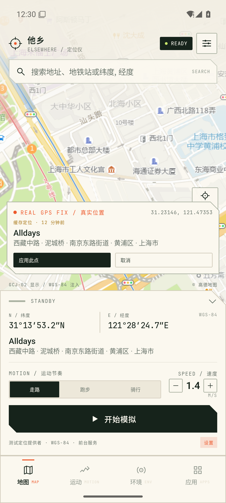
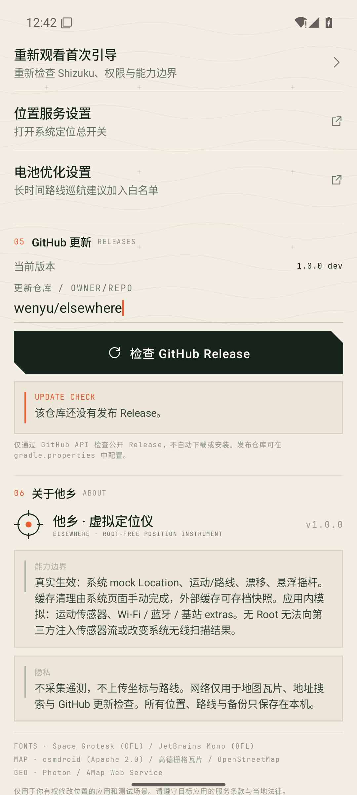

# 他乡 / ELSEWHERE

**一台跑在 Android 上的无 Root 位置仪。** 用 Shizuku 的 shell 通道把坐标交给系统定位栈，用一张地图、一个准星和一只悬浮摇杆，替身去别处。

- 版本：**1.0.0**
- 包名：`com.elsewhere.location`
- 平台：Android 8.0+（API 26+），targetSdk 35
- 形态：单 APK，本地优先，无账号、无遥测、无 Root
- 签名发行版：[`dist/elsewhere-1.0.0.apk`](dist/elsewhere-1.0.0.apk)
- 设计记录：[docs/DESIGN.md](docs/DESIGN.md) · 验证记录：[docs/TESTING.md](docs/TESTING.md)


---

## 它做了什么

### 地图与坐标

- 全屏地图 + 固定准星：拖图选点，松手即得到准星下的坐标。
- 高德栅格底图（GCJ-02 显示）与 OpenStreetMap 底图；内部和注入始终使用 WGS-84，转换在显示层完成。
- 地址搜索、经纬度直接输入、反向地理编码；中文结果优先。
- 一键开始 / 停止模拟，位置通过 Android 测试定位提供者（GPS / Network / Fused）注入。

### 真实 GPS 对齐

1. 静止时点右侧「真实」，读取系统当前定位。
2. 卡片给出坐标、地址、精度和新鲜度；如果是缓存位置，会明确标注「缓存定位 · N 分钟前」。
3. 确认后点「应用此点」，准星才移动。不会先偷偷把地图跳到真实位置。

### 运动与悬浮摇杆

- 走路 / 跑步 / 骑行三套速度包络；速度会在目标值附近平滑呼吸，不会瞬间跳变。
- 应用内摇杆和系统悬浮摇杆都能控制方向；松手后缓慢减速，不突兀停顿。
- 悬浮面板同时提供模式切换、速度微调、停止和收起。
- 路线巡航时，悬浮面板自动切换成环形进度视图，不再显示无效的摇杆。

### 模拟路线

- 在地图上连续加航点，实时显示总里程。
- 步行 / 跑步 / 骑行模式，可保存为路线并重播。
- 支持环线反复巡航；路线进度、距离和步数都在注入状态里更新。
- 路线按航点直线巡航。这是模拟器，不是真实道路导航引擎。

### 定位漂移与高级环境参数

- 多正弦平滑漂移，可直接叠加在注入坐标上；可调幅度与速度。
- 咖啡馆 / 地铁 / 办公室场景预设。
- Wi-Fi、蓝牙、基站字段随 `Location` 的 `extras` 一起发出，并在界面里预览。
- **这些无线电字段不会改变系统 Wi-Fi / 蓝牙 / 基站扫描结果**，第三方 App 仍可读取真实无线电信息。

### 运动传感器（应用内）

加速度、陀螺仪、重力、线性加速度、步数、步伐检测六个通道，给应用内的运动推演和回放使用。

- 会随速度、步频、路线坡度产生数值变化。
- **不会把传感器流注入其他 App。** 无 Root 的 Shizuku 没有系统传感器写入权限，界面中对此有明确标注。

### 应用与缓存

- 扫描带桌面入口的应用；通过 DEX 字符串检测高德 / 百度地图 SDK，作为参考提示。
- 读取目标应用缓存占用（需要 Usage Access）。
- 打开系统应用信息页，由用户手动执行「存储和缓存 → 清除缓存」。
- 可保存目标应用**可访问的外部缓存**快照，并可写回。
- 不读取、不备份系统私有内部缓存；写回后的文件归属仍受平台限制。详见下文。

### 首次校准与诊断

- 三步首次引导：介绍 → Shizuku 通道 → 权限校准。
- 自动请求 Shizuku 授权、模拟位置 AppOp、悬浮窗权限。
- 系统诊断：Shizuku 服务、授权、模拟位置 AppOp、精确位置、悬浮窗、通知、电池优化、系统定位开关、Hook / su 信号、反 Mock 检测状态。
- 只读 Hook 日志；不依赖 Root / LSPosed，也不能绕过目标应用的 Mock 检测。
- GitHub Release 更新检查；可配置仓库，不自动下载或安装。

---

## 真实 / 模拟边界

| 能力 | 实际效果 | 说明 |
| --- | --- | --- |
| 系统定位 | **真实注入** | 通过 `test provider` 写入 GPS / Network / Fused；系统会把 Location 标记为 mock。 |
| 坐标、路线、运动、漂移 | **真实注入** | 全部在 `MockLocationService` 的 tick 里计算并推送。 |
| 悬浮摇杆 | **真实系统悬浮窗** | `TYPE_APPLICATION_OVERLAY`，跨应用可用。 |
| 加速度 / 陀螺仪 / 重力 / 步数 | **应用内推演** | 无 Root 无法把传感器流写入系统或其他 App；界面标注 `APP-ONLY`。 |
| Wi-Fi / 蓝牙 / 基站 | **Location extras** | 仅作为附加字段，不改变扫描结果。界面标注 `APP-SIDE EXTRAS`。 |
| 清理缓存 | **系统页面手动完成** | Shizuku shell 没有 `INTERNAL_DELETE_CACHE_FILES`；Android 15 上 `pm clear --cache-only` 不可用。 |
| Hook / Root 状态 | **只检测** | 不注入、不绕过；`LIMITED` 是诚实结论。 |

> 这是测试 / 开发工具，不是反检测产品或云手机。请只在你有权修改位置的设备、应用和测试场景中使用。

---

## 安装

### 直接安装发行版

```powershell
adb install dist/elsewhere-1.0.0.apk
```

首次打开会进入三步校准。

### 准备 Shizuku（推荐）

1. 从 [Shizuku Releases](https://github.com/RikkaApps/Shizuku/releases) 安装 Shizuku。
2. 打开 Shizuku，按应用内指引开启无线调试并启动服务。
3. 回到「他乡 → 首次校准 / 系统与诊断」，点击「打开 Shizuku 启动」。
4. 在 Shizuku 中授权「他乡」，回到应用会自动刷新。
5. 点击「授权 / 配置」，应用会通过 shell 完成模拟位置 AppOp、悬浮窗和通道检查。

本次验证环境：Shizuku **13.6.0**，服务以 `shell`（UID 2000）身份运行，Android 15。

### 无 Shizuku 的降级路径

系统 mock location 的底层机制是 AppOp，不必须 Shizuku：

1. 开发者选项 → **选择模拟位置信息应用** → 选择「他乡」。
2. 授予精确位置、通知。
3. 在系统「显示在其他应用上层」中允许「他乡」悬浮窗（可选）。
4. 直接开始模拟。

没有 Shizuku 时，模拟位置仍可工作；缓存快照、自动化 AppOp 和诊断中的 shell 相关项目会显示为不可用。

### 运行时权限

- 精确位置：读取真实 GPS、维持前台定位服务。
- 通知：前台服务常驻通知（Android 13+ 需要）。
- 悬浮窗：系统级摇杆。
- 用量访问：读取目标应用缓存大小（可选）。
- 电池优化白名单：长时间路线巡航建议加入。

---

## 使用

### 选点与启动

1. 拖动地图，把目标点放到准星下。
2. 底部仪表板显示纬度、经度、反向地址和当前模式。
3. 点「开始模拟」；状态变为 `MOCKING`，系统定位栈收到 mock 坐标。
4. 再点即可停止；停止后测试提供者会被移除，系统定位恢复。

### 真实位置

静止时点地图右侧「真实」。如果有实时 GPS，卡片显示「实时 GPS · 精度 ±x.x m」；如果只有系统缓存，卡片显示「缓存定位 · N 分钟前」，不会把缓存伪装成实时定位。

### 悬浮摇杆

启动模拟后，悬浮摇杆自动出现：

- 按住并拖动：控制方向。
- 松手：平滑减速。
- 底座上方切换走路 / 跑步 / 骑行。
- `+ / -` 微调当前模式的目标速度。
- 方按钮停止，`×` 收起。
- 悬浮窗位置可以拖动。

### 路线

1. 地图右侧「路线」进入规划。
2. 在地图上连续加航点；底部显示总里程。
3. 可输入路线名、选择模式、开启环线。
4. 「保存路线」只保存；「保存并巡航」保存并立刻开始。
5. 已保存路线在「运动 → 模拟路线」中，可再次巡航或编辑。

### 环境参数

- 在「环境」中开启漂移，设置幅度。
- 选择咖啡馆 / 地铁 / 办公室预设，或逐项编辑 Wi-Fi、蓝牙、基站。
- 点击「写入 Location extras」后，mock Location 的 extras 中才会带上这些字段。
- 参数在下一次开始模拟时生效；正在运行时会提示重新开始。

### 应用缓存

1. 进入「应用」，选择目标应用。
2. 点「手动清理定位缓存」。
3. 对话框会说明系统限制，并可勾选「先备份外部缓存」。
4. 点「打开系统清理页」，在系统的应用信息页执行「存储和缓存 → 清除缓存」。
5. 回到他乡，应用会提示结果并提供最新快照记录。

> 高德 / 百度等 SDK 的定位缓存通常在应用 cache 目录中；系统清理页会一并清掉。无 Root 工具无法提供可验证的静默清理。

---

## 能力边界

### 无 Root 不能做的事

- 不能向其他 App 注入传感器流（加速度、陀螺仪、重力、步数等）。
- 不能改变系统 Wi-Fi / 蓝牙 / 基站的扫描结果。
- 不能修改其他应用的私有内部缓存，也不能在 Android 15 上以 shell 静默执行 cache-only clear。
- 不能绕过目标应用的 mock location 检测或反作弊。
- 不能在未授权的情况下修改系统分区。

### 缓存快照的具体限制

应用把目标应用 `Android/data/<package>/cache` 中**可访问的外部缓存**打包到本应用的外部文件目录，并在写回时尝试用 `chmod a+rwX` 让目标应用可读。

但是：

- 写入者仍是 Shizuku 的 `shell` 身份，文件系统所有者不是目标应用。
- 目标应用是否读取这些文件，取决于厂商对 `Android/data` 的路径和权限策略。
- 系统私有内部缓存完全无法备份 / 恢复。
- 因此界面把动作称为「写回快照」，而不是承诺完整恢复。

### 其他说明

- 更新检查不自动下载 APK；`wenyu/elsewhere` 是发布仓库占位，没发布 Release 时会显示「该仓库还没有发布 Release」。
- 高德栅格底图与 Web 地理编码服务有各自的条款；应用不内置任何 API Key。
- Photon 地理编码、OpenStreetMap 底图、GitHub API 均需要网络。
- 真实 GPS 在室内可能只能得到缓存定位；界面会明确标出。
- 已在 1080×2400、Android 15 模拟器上验证；其他厂商系统上的 AppOp 和悬浮窗行为可能不同。

---

## 构建

### 环境

- JDK 17 或 21（本机使用 JDK 21）
- Android SDK 35，Build Tools 35.0.0
- Gradle Wrapper 8.9

```powershell
$env:JAVA_HOME='D:\Program Files\Java\jdk-21'
$env:ANDROID_HOME='D:\Android\sdk'
$env:ANDROID_SDK_ROOT='D:\Android\sdk'

.\gradlew.bat :app:testDebugUnitTest :app:lintDebug :app:assembleDebug
```

产物：

- Debug：`app/build/outputs/apk/debug/app-debug.apk`
- Release（Gradle）：`app/build/outputs/apk/release/app-release-unsigned.apk`

### 发行版签名

本地签名密钥位于 `release/elsewhere-release.jks`（已 gitignore）。口令和别名记录在 `release/README.md`，请自行备份；丢失后无法以更新方式覆盖已安装的发行版。

```powershell
$bt = 'D:\Android\sdk\build-tools\35.0.0'
& "$bt\zipalign.exe" -f -p 4 app\build\outputs\apk\release\app-release-unsigned.apk dist\elsewhere-1.0.0-aligned.apk
& "$bt\apksigner.bat" sign `
  --ks release\elsewhere-release.jks `
  --ks-key-alias elsewhere `
  --ks-pass 'pass:Elsewhere-Release-2026' `
  --key-pass 'pass:Elsewhere-Release-2026' `
  --out dist\elsewhere-1.0.0.apk dist\elsewhere-1.0.0-aligned.apk
Remove-Item dist\elsewhere-1.0.0-aligned.apk
& "$bt\apksigner.bat" verify --print-certs dist\elsewhere-1.0.0.apk
```

发行签名证书 SHA-256：

```
27780366d4d1a041c0eb99b8b99bfafb9374de4d35af4ed840e422f2598349d0
```

APK 校验和见 [`dist/SHA256SUMS.txt`](dist/SHA256SUMS.txt)。Debug 与 Release 签名不同，不能互相覆盖安装；切换时先卸载旧版。

### 更新仓库

`gradle.properties`：

```properties
ELSEWHERE_UPDATE_REPO=owner/repo
```

也可以在应用「系统与诊断 → GitHub 更新」中编辑仓库地址，点「检查 GitHub Release」后会保存。版本比较读取公开 Release 的 `tag_name`；无 Release 时给出空状态。应用只展示版本、更新说明和下载入口，不自动下载安装。

---

## 架构

```
app/src/main/java/com/elsewhere/location/
├── MainActivity.kt               # 入口、权限 launcher、系统 Intent 事件
├── ElsewhereApplication.kt
├── AppContainer.kt
├── core/
│   ├── Geo.kt                   # haversine、方位角、距离格式化
│   ├── ChineseGeo.kt            # WGS-84 ↔ GCJ-02
│   └── Models.kt                # 设置、路线、环境、传感器、会话状态
├── location/
│   ├── MotionEngine.kt          # 纯 Kotlin 运动/路线/步态引擎
│   ├── DriftGenerator.kt        # 多正弦漂移
│   ├── MockLocationProvider.kt  # 测试定位提供者安装与推送
│   └── RealLocationProbe.kt     # 当前真实位置 / 缓存新鲜度
├── service/
│   └── MockLocationService.kt   # 前台服务、tick、通知、悬浮窗生命周期
├── overlay/
│   └── OverlayJoystickController.kt
├── shizuku/
│   └── ShizukuManager.kt        # 授权、AppOp、受控 shell、诊断
├── data/
│   ├── SettingsRepository.kt    # DataStore + JSON
│   ├── GeocodingRepository.kt   # Photon / 可选高德 Web 服务
│   ├── UpdateRepository.kt      # GitHub Release 检查
│   ├── TargetAppRepository.kt   # 应用扫描、图标、SDK 扫描、缓存大小
│   ├── CacheBackupRepository.kt # 外部缓存 tar 快照 / 写回
│   └── DiagnosticsRepository.kt
└── ui/
    ├── ElsewhereViewModel.kt    # 单一中央状态
    ├── map/                     # 地图、准星、真实位置、路线编辑
    ├── motion/                  # 速度、节奏、摇杆、路线、传感器
    ├── environment/             # 漂移、预设、无线电
    ├── apps/                    # 应用列表、缓存工作流
    ├── settings/                # Shizuku、诊断、地图、更新、关于
    └── onboarding/
```

核心状态流：

```
UI → ElsewhereViewModel → MockLocationService（Intent 命令）
                              ├─ MotionEngine → Location
                              ├─ MockLocationProvider → 系统定位栈
                              └─ MockSessionState → Compose / 悬浮窗
```

- WGS-84 是内部唯一坐标；GCJ-02 只在 AMap 显示和落点转换时出现。
- 运动引擎不依赖 Android，可做 JVM 单测。
- 悬浮摇杆用独立 ComposeView + 自定义 Lifecycle / SavedStateOwner 运行在系统 overlay 窗口。
- 前台服务使用 `location` 类型，持有运行期 wakelock，停止时移除测试提供者。

---

## 验证

已完成：

- `:app:testDebugUnitTest`：16 个 JVM 单测通过（Geo、ChineseGeo、MotionEngine、路线环线、更新版本比较、设置序列化）。
- `:app:lintDebug`：通过（保留少量非阻塞警告）。
- 1080×2400 / Android 15 模拟器：Shizuku 13.6.0，授权、AppOp、前台服务、悬浮摇杆、两条路线、真实 GPS 缓存标注、缓存快照写回、GitHub Release 检查均已手工验证。
- `dumpsys location` 可见 GPS / Network / Fused 三路 mock 位置，extras 携带 Wi-Fi / 蓝牙 / 基站字段。
- 停止后前台服务消失，测试提供者 override 被移除。

详细结果见 [`docs/TESTING.md`](docs/TESTING.md)。

---

## 截图

| | |
| --- | --- |
|  |  |
|  |  |
|  |  |
|  |  |
|  |  |

更多截图在 [`docs/screenshots`](docs/screenshots)。

---

## 第三方与许可

应用代码以 **MIT** 发布，见 [`LICENSE`](LICENSE)。

内置字体：

- Space Grotesk — SIL Open Font License 1.1
- JetBrains Mono — SIL Open Font License 1.1

主要依赖：

- [osmdroid](https://github.com/osmdroid/osmdroid) — Apache-2.0
- [Shizuku](https://github.com/RikkaApps/Shizuku) — Apache-2.0（未打包，仅客户端 API）
- [OpenStreetMap](https://www.openstreetmap.org/) 数据 — ODbL
- 高德地图栅格瓦片 / Web 地理编码 — 遵循高德服务条款；项目不内置 Key
- [Photon](https://photon.komoot.io/) — 公共地理编码服务
- [OkHttp](https://square.github.io/okhttp/) — Apache-2.0
- AndroidX / Jetpack Compose — Apache-2.0

第三方声明详见 [`THIRD_PARTY_NOTICES.md`](THIRD_PARTY_NOTICES.md)。

---

**免责声明**：本项目用于位置功能开发、自动化测试和演示。请遵守设备、目标应用及所在地区的法律与服务条款。作者不对用于欺诈、规避风控或未经授权的用途负责。
