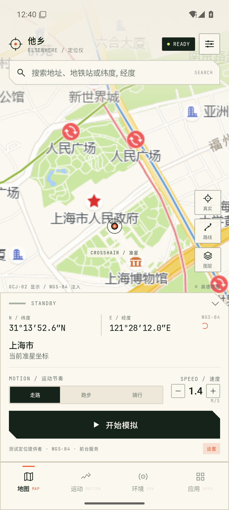
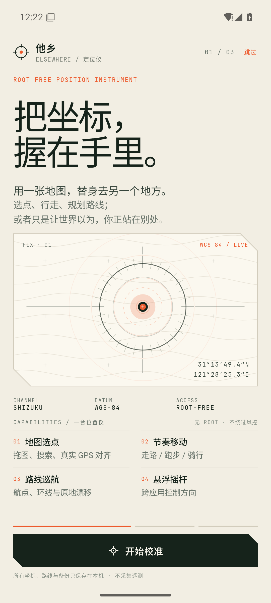
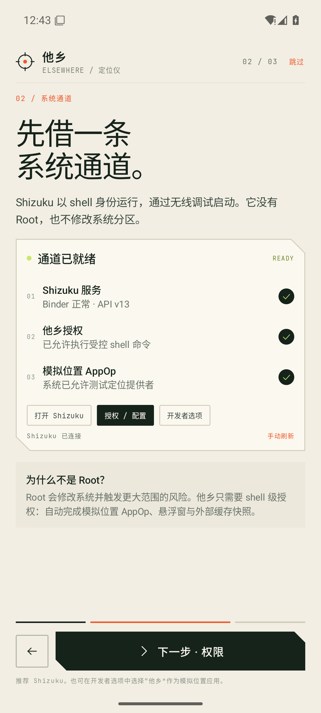
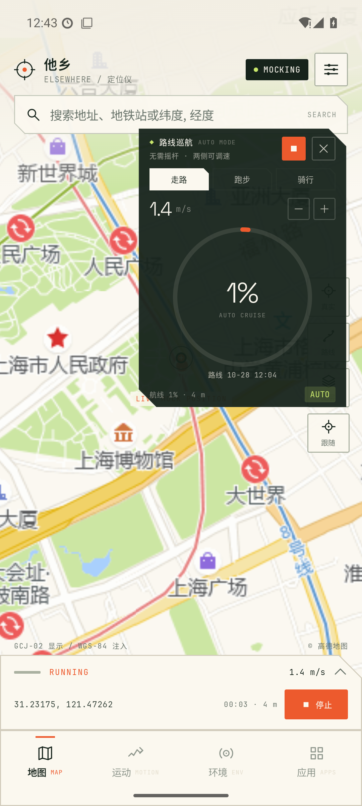
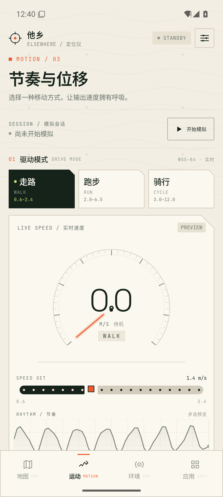
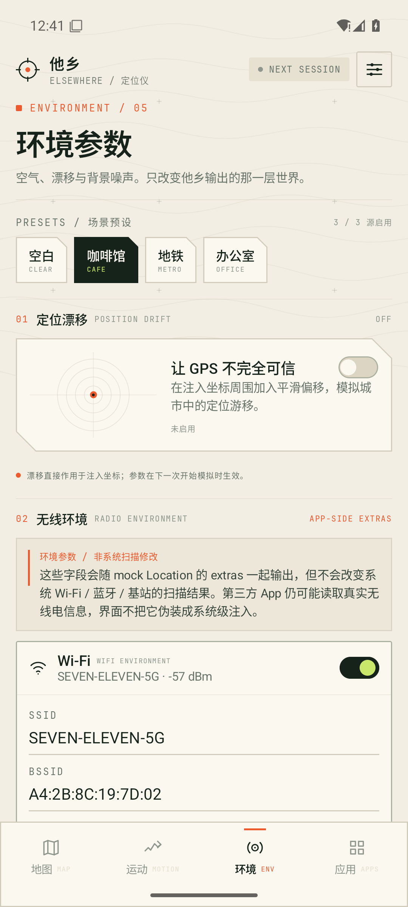
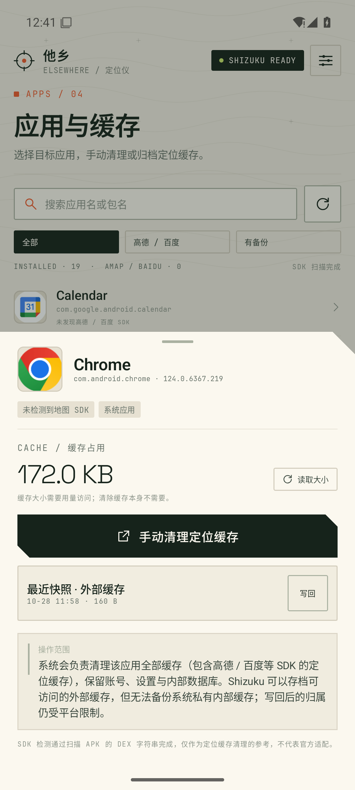
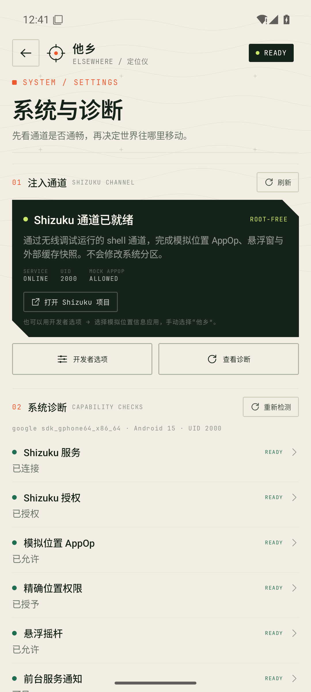

# 设计记录 · 他乡 / ELSEWHERE

> 方向 A「测绘仪 / Survey Console」。目标不是做一个更花哨的虚拟定位工具，而是让位置的移动看起来像一次可读、可复现的测量。

---

## 1. 品类判断

虚拟定位类产品的常见界面有两类：

1. **地图工具型**：地图 + 搜索 + 启动按钮，信息密度低，功能都藏进列表。
2. **游戏化控制台型**：大面积紫色渐变、发光摇杆、仪表盘化速度，看起来像外挂面板。

他乡选择了第三条路：**测绘仪器**。

地图是操作台，底部是读数纸；准星、刻度、断面线和等值线构成视觉语言。没有霓虹，没有拟物金属，也没有“黑客感”。这在功能上是合理的：用户需要在地图上确认一个点、读一组坐标、判断当前输出是不是 mock，而不是被界面催眠。

### 品类参照

- **Lockito / Fake GPS Joystick & Routes** 的品类习惯：地图上拖点、路线回放、悬浮摇杆、速度档位。
- **专业 GPS 工具 / 测量 App** 的读图习惯：WGS-84、精度、方位角、固定准星、明确的坐标格式。
- **地图产品** 的空间层级：地图永远在上层，控制面板浮在底部，工具按钮贴右侧。

我们吸收的是信息结构，不复制任何产品视觉。

### 实际参考素材

本轮工作环境的外网访问不稳定，公开商店截图页面多次超时或返回 429，未能稳定取得可再分发的参考图，因此项目内不分发第三方截图。设计基于上述品类的交互事实与地图工具的任务结构完成；没有把任何竞品截图当作 UI 素材。

---

## 2. 视觉方向

### 关键词

**纸张、墨、测量橙色、荧光石灰、等值线、切角、单线刻度、双语微型标注。**

### 色彩

| Token | 色值 | 用途 |
| --- | --- | --- |
| Paper | `#F2EEE3` | 全屏纸色背景 |
| PaperHigh | `#FBF8EF` | 卡片、面板、浮层 |
| PaperLow / PaperDeep | `#E7E1D2` / `#DCD5C4` | 选中底、滑轨、次级面 |
| Ink | `#16231B` | 主文字、主按钮、夜间悬浮面板 |
| InkSoft | `#36443B` | 正文 |
| Muted / Faint | `#69746B` / `#8F978D` | 次级信息、微标签 |
| Signal | `#ED5A2D` | 主操作、当前状态、路线 |
| SignalDeep / Wash | `#C74720` / `#F8DED1` | 状态强调 / 浅底 |
| Live | `#C9E76B` | 正在运行、ON、完成 |
| Green / Amber / Danger | `#206E52` / `#A97819` / `#B03A2B` | 能力状态 |
| OverlayInk | `#F216231B` | 悬浮摇杆半透明深底 |

设计原则：

- 只有「正在运行」和「已就绪」使用荧光石灰；不让它变成装饰色。
- 橙色只出现在当前动作、准星/路线、少量状态标签；不铺满大块区域。
- 状态色（绿 / 琥珀 / 红）只在诊断和权限意义下出现，不参与品牌装饰。
- 所有文字、按钮、地图标签的对比度高于纯装饰元素。

### 字体

- **Space Grotesk**：数字、英文标题、坐标读数。几何、略窄、有仪器感。
- **JetBrains Mono**：微标签、表头、状态码、代码式读数。
- **系统 CJK**：中文正文。大标题使用系统字重 600，保证中文字形不“翻译腔”。

字号层级：

- 64 / 46 / 34sp：页面主张与巨大读数。
- 28 / 23 / 19 / 17 / 15sp：中文信息层级。
- 8–10sp：双语微型标签与状态线。仅用于辅助阅读，不承载关键操作说明。

### 形状

- 切角（cut corner）作为唯一装饰性几何：卡片右上 / 左下切角，模拟测绘图纸与仪器面板。
- 1dp 细线；不使用大面积投影。
- 自定义矢量图标，线宽统一，与 8sp 单线标注同一“工程图”气质。
- 圆仅用于准星、摇杆底座、状态点。其余保持纸片 / 面板感。

---

## 3. 布局

### 全屏地图

- 地图覆盖状态栏下方全屏，顶部压一层浅 Paper 渐隐，保证品牌、状态和搜索可读。
- 品牌锁定在左上，状态胶囊在右上，搜索框横跨第二行。
- 右侧地图工具竖排：真实、路线、图层、跟随。
- 固定准星位于地图中心；标签 `CROSSHAIR / 准星` 使用独立白底。
- 底部地图工具台有三种高度：收起 / 标准 / 展开。收起时只留坐标和启动；展开时出现速度、模式和设置。
- 地图底部左侧标注 `GCJ-02 显示 / WGS-84 注入`，右侧显示数据源。

### 非地图页

- 统一使用 `ScreenHeader`（品牌 + 状态 + 大标题 + 一段说明）。
- 页面下方使用 `SectionRule` 编号分区（`01 / 驱动模式`），让长页有测绘手册的翻阅感。
- 背景是缓慢漂移的等值线；它们只做空间组织，不干扰文字。
- 内容页面顶部固定避开状态栏；滚动时不会把正文塞到时间和电量下面。

### 留白

- 使用 16 / 20dp 页边距，卡片内 14–18dp。
- 大标题和说明之间保持 10–14dp，不会挤成“营销落地页”。
- 地图面板、浮层、卡片各自有明确边界，但共享纸色与切角语言。

---

## 4. 组件

| 组件 | 设计意图 |
| --- | --- |
| `PrimaryAction` | 切角深墨大按钮；一个屏只有一个主行动。 |
| `TinyActionChip` | 小型方框操作，用于对话框/次级任务；深底版本保证悬浮面板可读。 |
| `SurveySwitch` | 自制 40×22 开关；深墨开、纸色关、Live 滑块。避免 Material 默认尺寸破坏密度。 |
| `SpeedGauge` | 58sp 大数字 + 半圆刻度 + 橙色针；表示实时速度而不是装饰表盘。 |
| `RhythmWave` | 步态预览折线；把“速度有呼吸”变成可见信号。 |
| `JoystickPad` | 同心圆 + 十字刻度；按住/拖动是唯一主要交互。 |
| `SectionRule` | 编号 + 中英双语标题 + 细线；建立手册目录感。 |
| `NoticeBlock` | 纸色底 + 侧线；用于能力边界，不做成警告弹窗。 |
| `HookConsole` | 深墨只读终端；把系统信号当作证据而不是营销。 |
| `CutCornerShape` | 3–20dp 切角；全应用统一的“图纸裁切”。 |
| `Hairline` | 1dp 线；地图与卡片的层级。 |

### 状态语言

- `READY`：当前能力可用（不是“保证注入成功”）。
- `MOCKING`：系统定位栈正在接受本应用的 mock 位置。
- `RUNNING`：前台服务正在运行。
- `LIMITED`：平台明确不允许或需要用户手动处理。
- `APP-ONLY` / `APP-SIDE EXTRAS`：普通 App 不假装传感器和无线电是系统注入；无线 Hook 只存在于 LSPatch/VirtualXposed 目标进程。

这是刻意的诚实设计：用户看到 `LIMITED`，比看到一个绿色勾但实际无效更安全。

---

## 5. 关键交互

### 双阶段真实位置

不做“点真实 → 地图直接跳走”。流程是：

1. 点「真实」→ 锁定中（最多约 14 秒）。
2. 显示卡片：坐标、地址、精度、缓存年龄。
3. 用户确认 → 应用此点；或取消。

这样用户知道地图为什么移动，也能识别“这不是实时 GPS，只是系统缓存”。

### 摇杆的速度节奏

- 摇杆向量只决定方向；速度由模式的目标速度包络决定。
- 加速和减速都有阻尼；松手不会瞬间归零。
- 跑步/骑行模式拥有独立的包络周期和速度区间。
- 悬浮面板显示实时速度和大数字，让“按住走”是可感知的。

### 路线巡航

- 进入路线模式后，地图工具按钮变成「取消」，底部切换到路线工作台。
- 加航点、总里程、模式、环线、保存/巡航都在一屏内完成。
- 开始巡航后，悬浮面板自动变成环形进度；不显示一个不可操作的摇杆。
- 路线完成和环线状态在悬浮面板 / 运动页中更新。

### 权限与降级

- 每一步先解释“为什么”，再给操作。
- Shizuku 不可用时，明确给出开发者选项路径，不把用户困在死胡同。
- 权限已授予时，不再反复弹窗；状态行直接显示 READY。
- 受平台限制的缓存操作，在对话框里直接说明；“先备份”是一个可选动作，不是默认自动执行。

---

## 6. 响应式与系统边缘

- 适配 Android 15 的 edge-to-edge：
  - 地图全屏延伸到状态栏下，用顶部渐隐保证可读。
  - 非地图页在根容器上使用状态栏内边距，避免滚动内容穿透状态栏。
  - 悬浮窗、底部导航和手势条分别处理 insets。
- 底部导航是固定 4 项：地图 / 运动 / 环境 / 应用。设置通过右上角进入，用返回栈而不是第五个 tab。
- 地图 `MapView` 生命周期显式管理，离开页面时正确 detach，避免瓦片加载器失效。
- 文字最大行数、ellipsis 和卡片高度在截图设备上逐一检查；长中文文案优先换行而不是缩小字号。

---

## 7. 设计取舍与已知问题

做对了的：

- 地图是视觉主角，不是被卡片覆盖的背景。
- 橙色和荧光绿承担不同语义，颜色不泛滥。
- “诚实边界”是设计的一部分，不是文档补丁。
- 地图、运动、环境、应用四页有清晰的任务差异，但共享一套仪器语言。

还可以继续打磨的：

- 8sp 微标签是审美选择，在强光或极低端屏幕上的可读性仍不如 10sp；关键说明已经放在正文层，但可以再做一轮字号可达性测试。
- 路线编辑时地图工具会盖住部分右侧航点；后续可以按航点坐标自动把地图中心向左上偏移，或把工具收成浮层。
- 环境页的开关密度较高，可增加“当前会话已生效 / 下次会话生效”的状态区分。
- 地图瓦片属于第三方数据，文字和空白 callout 受瓦片源影响，不能完全控制。
- 缺少平板/横屏专门布局；当前按手机竖屏优化。

---

## 8. 证据

| 页面 | 截图 |
| --- | --- |
| 首次校准 |  |
| Shizuku 通道 |  |
| 地图与准星 |  |
| 悬浮路线巡航 |  |
| 运动与节奏 |  |
| 环境参数 |  |
| 应用缓存 |  |
| 系统诊断 |  |

方向不是“像某个现成产品”，而是把位置输出这件抽象的事，翻译成一套可读的测量动作：落点、读数、确认、运行、停止。

---

## 9. 新增功能的视觉规则（2026-10-29）

### 路线录制

录制状态必须比普通路线卡更“热”：深墨底、Live 绿点、实时时长、距离和采样点，以及「结束并保存 / 放弃」两个明确动作。录制不是自动开始的后台行为——用户必须在一场模拟中主动按下；模拟停止时若录制已足够长，则尝试自动保存，并在通知里说明。

### Frida Sensor Bridge

Frida 是一个**外部注入**能力，界面不能把它画成普通的“已开启传感器注入”。因此：

- 区块标题带 `EXTERNAL INJECTION`；
- 先放琥珀色边界说明，再放注入路径选择（JDWP / Root / Gadget）、目标包名和生成按钮；
- 状态区把 `TARGET`（是否 debuggable）、`JDWP`、Shizuku、SU、Frida Server 分开显示；
- 生成结果面板明确写 `FRIDA SCRIPT / READY`，而不是 `HOOK ACTIVE`；
- JDWP 结果面板提供「导出 / 分享一键注入包」，把脚本、MIT loader、目标包名、固定 Frida 16.7.19 版本和 Windows/macOS/Linux 启动脚本打包；分享面板负责把它送到电脑；
- 说明 Shizuku 没有 ptrace 权限；JDWP 免 Root 只对 debuggable 目标有效，外部 loader 才是执行者。

LSPatch / VirtualXposed 以独立的「05 LSPatch / Xposed」卡片出现：导出模块 APK、写入/复制运动与无线环境配置、说明 patch/虚拟空间边界。架构图把 LSPatch → Sensor + Wireless Module 画成独立部署路线；模块只作用于被 patch/虚拟化的目标进程。

这是把“诚实边界”延伸到新功能：可以做脚本生成、目标检测、部署和命令导出，但不能把“脚本已生成”写成“Hook 已生效”。

### 架构图

采用 Archify 原生 architecture 版式，明确画出不同信任级的路径：无 Root 的定位链路，以及外部 Frida 运行时的 JDWP（debuggable）、Root frida-server 和 Gadget 三条注入链。架构图在 README 中以静态 PNG 呈现，同时保留可交互 HTML。
